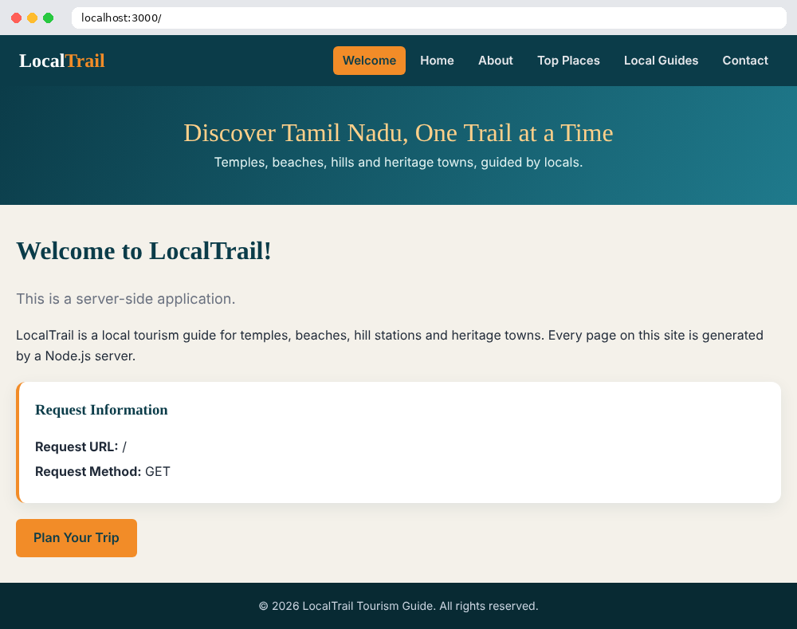
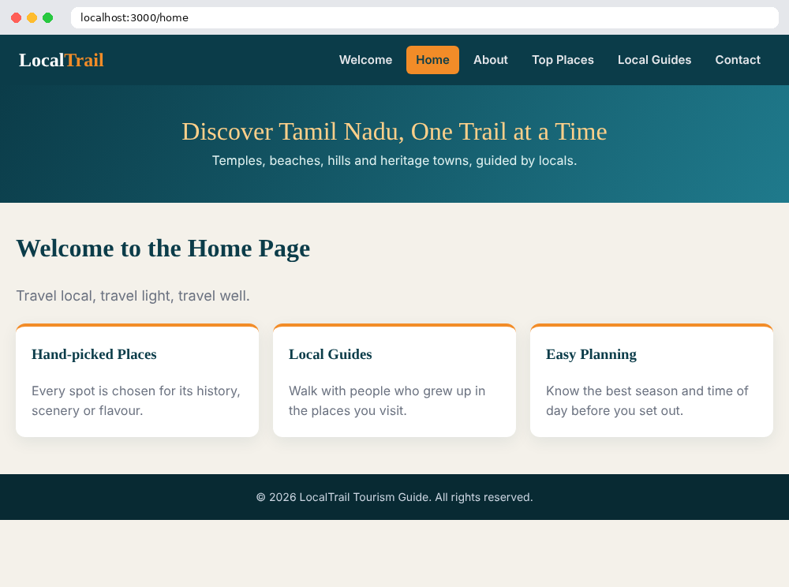
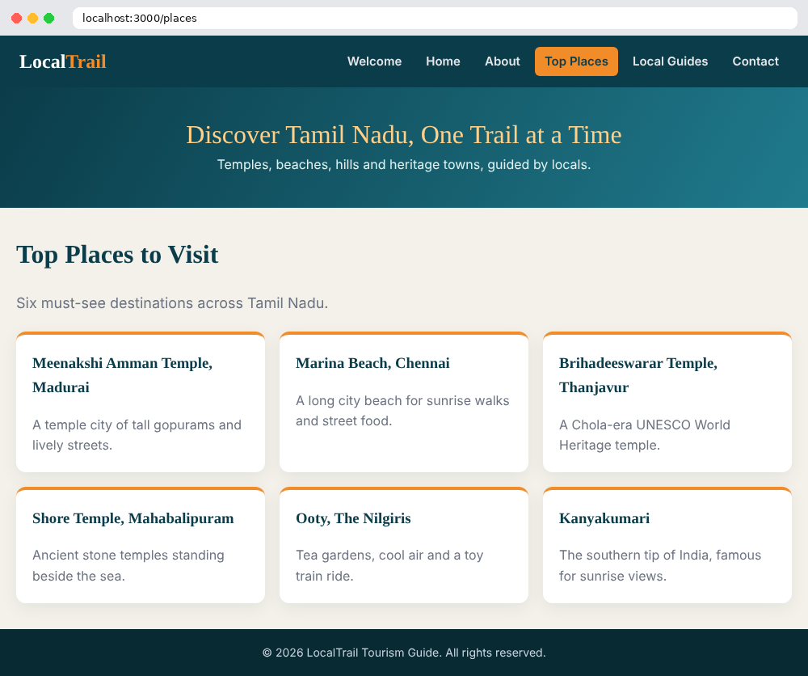
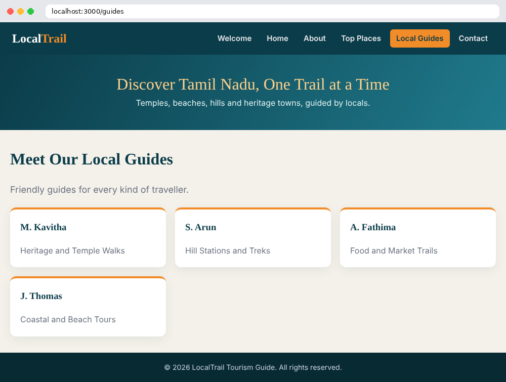
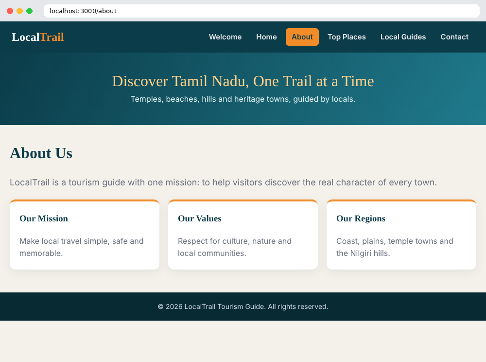
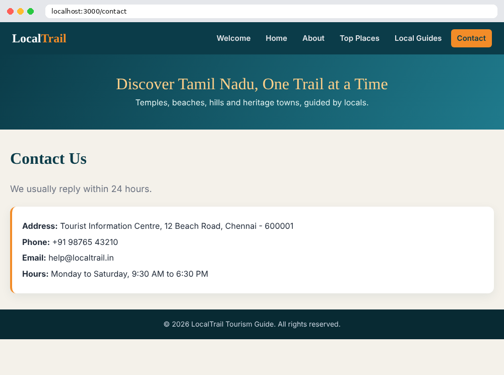

# LocalTrail - Local Tourism Guide
### Ex. 10 | 23CS2049 Web Technology Lab

A lightweight, dependency-free local tourism guide web application served by a native **Node.js HTTP Server**.

---

## 🌐 Live Website

- **Live URL:** [https://harshad062.github.io/EXP-10/](https://harshad062.github.io/EXP-10/)
- **Repository:** [https://github.com/harshad062/EXP-10](https://github.com/harshad062/EXP-10)

---

## 🚀 Quick Start (Local)

Run the Node.js HTTP server directly without any external dependencies:

```bash
# Start the server
node server.js
```

Then open your browser and navigate to:
**[http://localhost:3000](http://localhost:3000)**

---

## 🧭 Routes & Pages

| Route | Page | Description |
|---|---|---|
| `/` | **Welcome** | Landing page with dynamic request information (Method, URL) |
| `/home` | **Home** | Overview of places, local guides, and travel planning |
| `/about` | **About Us** | Mission, values, and covered regions across Tamil Nadu |
| `/places` | **Top Places** | 6 hand-picked destinations (Madurai, Marina, Thanjavur, Mahabalipuram, Ooty, Kanyakumari) |
| `/guides` | **Local Guides** | Profiles of experienced local guides |
| `/contact` | **Contact** | Tourist Information Centre address, phone, email, and hours |
| *other* | **404 Not Found** | Friendly error page with navigation back to Welcome |

---

## 📸 Screenshots

| Welcome Page | Home Page |
|:---:|:---:|
|  |  |

| Top Places | Local Guides |
|:---:|:---:|
|  |  |

| About Us | Contact Us |
|:---:|:---:|
|  |  |

---

## 🛠️ Features

- **Zero Dependencies**: Uses standard Node.js `http` module (`require('http')`). No `npm install` needed.
- **Dynamic HTML Templating**: Reusable layout function with responsive navigation header, hero banner, content cards, and footer.
- **XSS Protection**: HTML entities escaped (`escapeHtml`) for request data injection.
- **Deployable Anywhere**: Configured for local Node.js (`server.js`), GitHub Pages static preview (`index.html`), and Vercel serverless functions (`api/index.js`).
